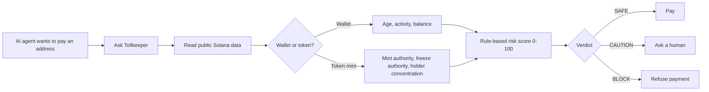
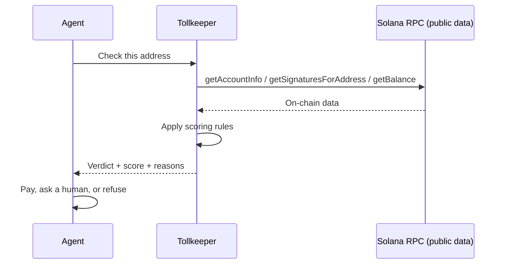

<div align="center">

# 🏛️ Tollkeeper

### The toll gate for AI agent payments on Solana

**Check before you pay.** Tollkeeper reads public on-chain data and tells an AI agent (or a person) whether a Solana wallet or token is safe to pay, with a clear verdict and the reasons behind it.

[](https://colosseum.com/worldsfair)
[](https://solana.com)
[](#-honest-status)


[**Live demo**](#) · [**Pitch video**](#) · [**Demo video**](#) · [**Report a bug**](../../issues)

</div>

<!-- TODO: replace each (#) above with your real links before submitting. Delete any you do not have. -->

---

## 📑 Table of contents

- [The problem](#-the-problem)
- [The solution](#-the-solution)
- [How it works](#-how-it-works)
- [Features](#-features)
- [Scoring methodology](#-scoring-methodology)
- [Screenshots](#-screenshots)
- [Getting started](#-getting-started)
- [Agent integration (API contract)](#-agent-integration-api-contract)
- [Project structure](#-project-structure)
- [Honest status](#-honest-status)
- [Roadmap](#-roadmap)
- [Security and disclaimer](#-security-and-disclaimer)
- [About the author](#-about-the-author)

---

## 🚨 The problem

AI agents are starting to do more than answer questions. Soon you will give an agent a budget and it will pay for data, tools and services by itself, with no bank and no human clicking approve.

On a blockchain, a scam wallet looks just like any other address. If an agent pays it, the money is gone, and nobody was watching.

## 🛡️ The solution

Tollkeeper is a safety check that sits between an agent and a payment. Before paying, the agent asks Tollkeeper: *"Is this address safe to pay?"*

Tollkeeper reads the public on-chain record and answers with one of three verdicts, plus the reasons:

| Verdict | Meaning | What the agent should do |
|---|---|---|
| 🟢 **SAFE** | Looks normal | Pay |
| 🟡 **CAUTION** | Something is off | Ask a human first |
| 🔴 **BLOCK** | Looks risky | Do not pay |

## ⚙️ How it works



<details>
<summary><b>See the request flow as a sequence</b></summary>



</details>

## ✨ Features

<!-- TODO: before submitting, make sure every row below is true of your finished app. Change ✅ to 🚧 or delete the row if it is not. -->

| Feature | Status |
|---|---|
| Wallet and token address checker with automatic type detection | ✅ |
| Verdict (SAFE / CAUTION / BLOCK), 0-100 risk score and reasons with evidence | ✅ |
| Copy and download the report as JSON | ✅ |
| Check history and watchlist (stored locally in your browser) | ✅ |
| Simulated payment-agent demo that asks Tollkeeper before paying | ✅ |
| Light and dark themes | ✅ |
| Friendly handling of invalid addresses, network errors and RPC rate limits | ✅ |
| Demo sign-in and Phantom wallet connect (demo-level, no real accounts) | 🚧 |
| Hosted API for agents | 🚧 |

## 📊 Scoring methodology

Tollkeeper uses **simple, explainable rules**, not a trained machine-learning model. Every point in the score maps to a reason you can read and verify on a public explorer.

<details>
<summary><b>Wallet rules</b></summary>

| Signal | Risk added |
|---|---|
| No transaction history | +40 |
| Wallet younger than 7 days | +35 |
| Fewer than 5 transactions | +15 |
| Zero balance | +10 |

</details>

<details>
<summary><b>Token rules</b></summary>

| Signal | Risk added |
|---|---|
| Mint authority not renounced (creator can print more) | +30 |
| Freeze authority present (creator can freeze accounts) | +20 |
| Top 10 holders own more than 80% of supply | +35 |
| Top 10 holders own more than 50% of supply | +20 |

</details>

**Verdict bands:** `0-24` SAFE · `25-59` CAUTION · `60+` BLOCK

All thresholds live in one config file (`src/config/thresholds.ts`) so they are easy to tune.

## 🖼️ Screenshots

<!-- TODO: add real screenshots of your app to a /docs folder, then replace these placeholders. -->

| Check result | Agent demo |
|---|---|
|  |  |

## 🚀 Getting started

**Requirements:** Node.js 18+ and npm.

```bash
# 1. Clone the repo
git clone https://github.com/BhavishyasriMatangi-rgb/tollkeeper.git
cd tollkeeper

# 2. Install dependencies
npm install

# 3. Add your Solana RPC URL
cp .env.example .env
# then edit .env and set VITE_SOLANA_RPC_URL

# 4. Run the app
npm run dev
```

**Environment variables**

| Variable | Description | Default |
|---|---|---|
| `VITE_SOLANA_RPC_URL` | Solana JSON-RPC endpoint. A free Helius key is recommended because the public node often rate-limits browsers. | `https://api.mainnet-beta.solana.com` |

> Never commit your `.env` file or any API key.

## 🔌 Agent integration (API contract)

This is the **contract design** an agent would use. In this prototype the check runs in the browser, so this describes the intended interface rather than a hosted production service.

```http
GET /check?address=<SOLANA_ADDRESS>
```

```json
{
  "address": "<SOLANA_ADDRESS>",
  "type": "wallet",
  "verdict": "CAUTION",
  "score": 45,
  "reasons": [
    { "signal": "wallet_age", "detail": "Wallet is about 2 days old", "points": 35 },
    { "signal": "low_activity", "detail": "Only 3 transactions", "points": 15 }
  ]
}
```

*The values above are an example response shape, not real data.*

```ts
// How an agent would use it
const res = await check(address);
if (res.verdict === "BLOCK") throw new Error("Payment refused by Tollkeeper");
if (res.verdict === "CAUTION") await askHumanApproval(res);
await pay(address, amount);
```

## 🗂️ Project structure

<!-- TODO: adjust to match the files your app actually has. -->

```text
tollkeeper/
├── src/
│   ├── components/      # UI building blocks
│   ├── pages/           # Landing, dashboard, checker, agent demo, history
│   ├── lib/
│   │   ├── solana.ts    # RPC calls to read public on-chain data
│   │   └── scoring.ts   # Turns data into a score and reasons
│   └── config/
│       └── thresholds.ts
├── docs/                # Screenshots
├── .env.example
└── README.md
```

## 🔍 Honest status

Being clear about what is real and what is not:

- ✅ **Real:** the checker reads live public Solana data and applies the rules above.
- 🧪 **Simulated:** the payment agent in the demo is scripted. It is not an LLM and it does not move real money.
- 🧪 **Demo-level:** sign-in is stored locally in your browser and is not real account security.
- ❌ **Not built yet:** a hosted API and a trained ML model.
- ⚠️ **Limits:** rule-based signals can miss new scams and can flag legitimate new wallets. Treat results as one input, not a guarantee.

## 🗺️ Roadmap

- [x] Explainable rule-based wallet and token checker
- [x] Agent demo that checks before paying
- [ ] Hosted API that any agent can call
- [ ] Train a model on labeled scam and safe examples
- [ ] Connect an LLM-powered agent that uses Tollkeeper as a tool
- [ ] More signals: token age, liquidity, known scam lists
- [ ] Browser extension and wallet integrations

## 🔒 Security and disclaimer

- Tollkeeper is **read-only**. It never asks for private keys, never signs transactions and never holds funds.
- It provides risk signals from public on-chain data. It is **not financial advice** and **cannot guarantee safety**.
- This is a hackathon prototype. Do not rely on it as your only protection.

## 👩‍💻 About the author

**Bhavishya Sri Matangi** is a B.Tech student in AI and ML from India, interested in AI/ML, data science, cybersecurity and research.

[GitHub](https://github.com/BhavishyasriMatangi-rgb) · [LinkedIn](https://linkedin.com/in/bhavishya-sri-matangi-35618b35a)

Built for the [Colosseum Crypto World's Fair](https://colosseum.com/worldsfair) hackathon (Solana track).

---

<div align="center">

**Check before you pay.**

</div>
